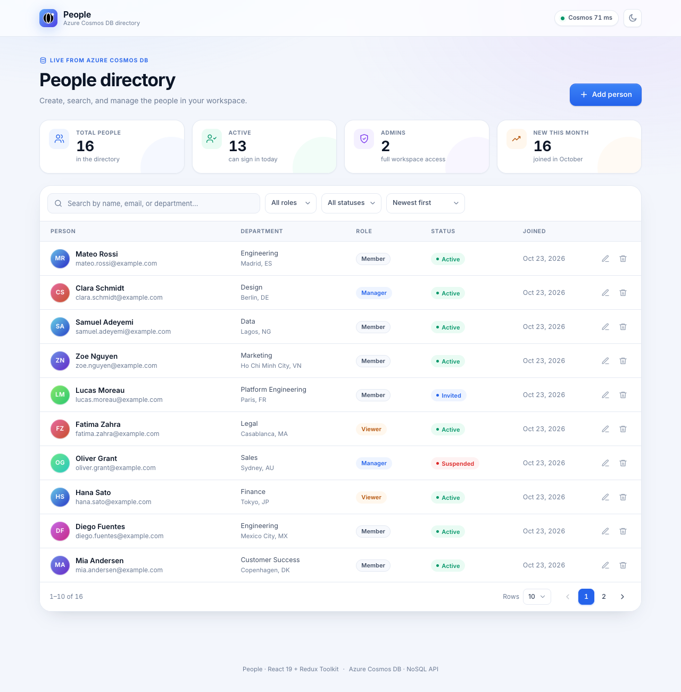

# People — Cosmos DB directory

A complete, production-shaped CRUD application for managing users, built with
**React 19**, **Redux Toolkit / RTK Query**, **TypeScript**, **Node.js + Express 5**
and **Azure Cosmos DB** (NoSQL API).



Search, filter, sort and paginate the directory; create and edit people in a
validated dialog; delete with confirmation; switch between light and dark
themes. In Cosmos mode, every change is persisted to Cosmos DB and reflected in
the live stats.

## Highlights

- **Full CRUD** — create, read, update and delete users through a typed REST API.
- **Real Cosmos DB persistence** — uses the default generic container
  (`app/items`, partition key `/partitionKey`) with a dedicated `users` logical
  partition. Runs against the local vNext emulator or a live Azure account.
- **Redux Toolkit + RTK Query** — cached list/detail queries, automatic
  invalidation of list + stats after every mutation, polling health check.
- **Optimistic concurrency** — responses carry an ETag; updates send `If-Match`
  and return `412` when someone else changed the record first.
- **End-to-end type safety** — Zod schemas validate every request; the client
  mirrors the API contract in TypeScript.
- **Thoughtful UX** — debounced search, filter-aware pagination, skeleton
  loading, empty/error states, toasts, accessible dialogs and responsive layout.
- **Tests** — 23 server tests (Supertest API + config/ETag unit tests) and 12
  client tests (Vitest + Testing Library), plus a real-browser QA flow exercised
  against the Cosmos emulator.

## Stack

| Layer      | Technology                                             |
| ---------- | ------------------------------------------------------ |
| UI         | React 19.3, Redux Toolkit 2.13, React Redux 9.3        |
| Build      | Vite 8.3, TypeScript 7.0                               |
| Styling    | Hand-written CSS with design tokens + light/dark themes |
| API        | Node.js 22+ (tested on 26.11), Express 5.3, Zod 4.6    |
| Data       | Azure Cosmos DB for NoSQL, `@azure/cosmos` 4.10        |
| Tests      | Vitest 5, Supertest 7, Testing Library                 |

## Data model

The app uses the database **`app`** and the default generic **`items`**
container, whose partition key is `/partitionKey`. User documents live in their
own logical partition so they coexist safely with any other documents in that
shared container:

```jsonc
{
  "id": "0f6f1c2e-…",           // UUID, also the document id
  "partitionKey": "users",       // container partition key value
  "type": "user",                // discriminator for shared containers
  "firstName": "Amara",
  "lastName": "Okafor",
  "email": "amara.okafor@example.com",
  "phone": "+1 415 555 0132",
  "department": "Platform Engineering",
  "location": "San Francisco, US",
  "role": "admin",               // admin | manager | member | viewer
  "status": "active",            // active | invited | suspended
  "notes": "Owns the identity platform.",
  "createdAt": "2026-10-23T01:44:20.770Z",
  "updatedAt": "2026-10-23T01:44:20.770Z"
}
```

Every query is scoped to `partitionKey = @users AND type = 'user'`. If you later
create a dedicated `users` container, change `COSMOS_CONTAINER` (and, if its
partition key path/value differs, `COSMOS_PARTITION_VALUE`) in `.env` — no code
changes required.

> The container has no composite index, so list ordering uses a single sort key.
> That is why sorting happens on `createdAt`, `updatedAt` or `lastName` only.

## Getting started

`npm run dev` starts the whole app against a seeded, in-memory data store — no
Docker and no Azure account required:

```bash
npm install
npm run dev         # API :8080, Vite UI :3000
```

Open <http://localhost:3000>. The API seeds 16 demo people on startup; changes
persist until the API restarts. The Vite dev server proxies `/api`, so there are
no CORS issues in development. If `:8080` or `:3000` is already taken,
`run.sh` picks the next free port and logs the URLs it used.

To use Cosmos DB instead, follow the steps below and start with
`npm run dev:cosmos`.

### Cosmos DB mode (local emulator)

**Prerequisites for Cosmos mode:** Node.js ≥ 22.12 (`.nvmrc` pins 26), npm 11+,
and Docker (for the local Cosmos DB emulator) or a live Azure Cosmos DB account.

#### 1. Install and configure

```bash
npm install
cp .env.example .env
```

The checked-in `.env.example` points at the Azure Cosmos DB vNext emulator on
`http://localhost:8081` and uses its public development key.

#### 2. Start Cosmos DB

```bash
npm run cosmos:up                  # docker compose up -d cosmos
curl http://localhost:8082/ready   # wait for "ready"
```

This starts
`mcr.microsoft.com/cosmosdb/linux/azure-cosmos-emulator:vnext-latest` with the
Data Explorer at <http://localhost:1234> and data persisted in the `cosmos-data`
Docker volume. The emulator supports Apple silicon (ARM64) and does not enforce
authentication — use it for local development only.

Create the `app` database and the default `items` container (partition key
`/partitionKey`):

```bash
npm run setup
```

`npm run setup` is idempotent, so it is safe to re-run. To wipe the emulator's
data completely, run `npm run cosmos:down` and then
`docker compose down --volumes`.

#### 3. Seed and run

```bash
npm run seed        # add -- --reset to replace existing users
npm run dev:cosmos  # API :8080 (Cosmos DB), Vite UI :3000
```

Open <http://localhost:3000>. The API proxies through Vite, so there are no CORS
issues in development.

### Using a live Azure Cosmos DB account

Replace the emulator values in `.env` with your account endpoint and primary key:

```dotenv
COSMOS_ENDPOINT=https://<account>.documents.azure.com:443/
COSMOS_KEY=<primary-key>
COSMOS_DATABASE=app
COSMOS_CONTAINER=items
COSMOS_PARTITION_VALUE=users
DATA_STORE=cosmos
```

```bash
az cosmosdb keys list -n <account> -g <resource-group> \
  --query primaryMasterKey -o tsv
npm run setup   # creates app/items if it does not exist
```

If the account already has the default container, `npm run setup` leaves it
untouched. Set `COSMOS_PARTITION_VALUE` to use a different logical partition for
user documents; queries are scoped to that partition, so other data in `items`
is never listed or modified.

### In-memory mode (no Cosmos DB)

This is what `npm run dev` uses by default. `npm run dev:memory` is an explicit
alias, and `DATA_STORE=memory npm run dev:server` runs just the API in memory:

```bash
npm run dev            # full app, in-memory store
npm run dev:memory     # same thing
npm run dev:cosmos     # full app backed by Cosmos DB from .env
```

The API seeds 16 demo people into an in-memory repository on startup. CRUD works
exactly as in Cosmos mode, but **all changes are lost when the API restarts** and
no Cosmos requests are made. The header shows “Memory store” instead of the
Cosmos latency. `npm run seed` is a no-op in this mode (seeding is automatic).

### Production build

```bash
npm run build       # client → client/dist, server → server/dist
npm start           # Express serves the API *and* the built SPA on :8080
```

## Scripts

| Command             | What it does                                              |
| ------------------- | --------------------------------------------------------- |
| `npm run dev`       | API + Vite UI with the seeded in-memory store             |
| `npm run dev:memory` | Alias for `npm run dev`                                  |
| `npm run dev:cosmos` | API + Vite UI backed by Cosmos DB from `.env`             |
| `npm run dev:server` | API only, with hot reload (`tsx watch`); honours `.env`   |
| `npm run dev:client`| Vite UI only                                              |
| `npm run build`     | Type-check + build client, compile server                  |
| `npm start`         | Serve the production build from Express                   |
| `npm run cosmos:up` | Start the local Cosmos DB vNext emulator (Docker)         |
| `npm run cosmos:down` | Stop the emulator                                       |
| `npm run setup`     | Create the `app` database and `items` container if missing |
| `npm run seed`      | Insert sample users (`-- --reset` clears first)           |
| `npm test`          | Run server then client test suites                        |
| `npm run typecheck` | Strict TypeScript checks for both workspaces              |

The dev scripts are thin wrappers around `scripts/run.sh`. You can also run it
directly from anywhere in the repo:

```bash
./scripts/run.sh            # in-memory store (default)
./scripts/run.sh cosmos     # Cosmos DB from .env
```

Run on a different pair of ports without editing anything:

```bash
WEB_PORT=5174 PORT=5001 npm run dev
```

`scripts/run.sh` points Vite's `/api` proxy at whichever API port it starts, and
if `PORT`/`WEB_PORT` are already taken it automatically uses the next free port
and prints the URLs to open.

## API

Base URL: `/api`. Errors are JSON: `{ "error": { "code", "message", "details?" } }`.
Validation failures return **422** with `details: [{ field, message }]`.

| Method   | Path               | Description                                          |
| -------- | ------------------ | ---------------------------------------------------- |
| `GET`    | `/health`          | API + Cosmos reachability and latency                |
| `GET`    | `/users`           | Paginated list (`page`, `pageSize`, `search`, `role`, `status`, `sort`, `order`) |
| `GET`    | `/users/stats`     | `{ total, active, admins, newThisMonth }`            |
| `GET`    | `/users/:id`       | Read one user; returns `ETag`                        |
| `POST`   | `/users`           | Create; returns `201`, `Location` and `ETag`         |
| `PATCH`  | `/users/:id`       | Partial update; accepts `If-Match`                   |
| `DELETE` | `/users/:id`       | Delete; `204`                                        |

```bash
curl 'http://localhost:8080/api/users?search=amara&role=admin&pageSize=10'
```

`sort` is one of `createdAt`, `updatedAt`, `lastName`; `order` is `asc` or
`desc`. Search matches first name, last name, full name, email and department.

**Concurrency example**

```bash
curl -i -X PATCH http://localhost:8080/api/users/<id> \
  -H 'Content-Type: application/json' \
  -H 'If-Match: "<etag from GET>"' \
  -d '{"status":"suspended"}'
```

If the document changed since it was read, the API returns **412** and the UI
asks the user to refresh instead of silently overwriting.

## Project structure

```
.
├── client/
│   └── src/
│       ├── components/      # Header, stats, toolbar, table, pagination, dialogs, toasts
│       ├── features/
│       │   ├── notifications/  # toast queue slice
│       │   ├── ui/             # theme slice
│       │   └── users/          # API slice, filters slice, types, validation, formatting
│       ├── hooks/           # useDebouncedValue
│       ├── pages/           # UsersPage (composition + data fetching)
│       ├── store/           # configureStore, typed hooks, root selectors
│       └── styles.css       # design tokens + components + responsive rules
├── server/
│   ├── src/
│   │   ├── middleware/      # request validation + error mapping
│   │   ├── models/          # Zod schemas, document/DTO types
│   │   ├── repositories/    # UserRepository interface, Cosmos + in-memory implementations
│   │   ├── routes/          # /api/users handlers
│   │   ├── scripts/         # setup (DB/container) + seed scripts
│   │   ├── app.ts           # Express app factory (testable, no listen)
│   │   ├── config.ts        # env loading + validation
│   │   └── index.ts         # bootstrap, graceful shutdown
│   └── test/                # Supertest API tests
├── docs/screenshot.png
├── docker-compose.yml       # Cosmos DB vNext emulator
├── .env.example
└── package.json             # npm workspaces: client + server
```

## Testing

```bash
npm test
npm run typecheck
```

- **Server** — validation, normalization, duplicate-email conflicts, search,
  filters, sorting, pagination, ETag/412, delete/404, stats, malformed JSON,
  health. The suite runs against an in-memory repository with the same
  semantics as the Cosmos implementation, so it needs no cloud credentials.
- **Client** — filter reducers, form validation, dialog accessibility and
  error rendering.
- **Real-browser QA** — create → search → edit → delete was exercised against
  the Cosmos DB vNext emulator through the running UI, with zero console errors
  or failed requests. The same CRUD flow, including ETag/412 optimistic
  concurrency, was also verified directly against the Cosmos DB API.

## Implementation notes

- **Repository pattern** keeps the HTTP layer independent of Cosmos DB and makes
  the API suite fast and deterministic.
- **Request validation** uses Zod with `.strict()` bodies, so unknown fields are
  rejected. Emails are trimmed and lowercased before persistence.
- **Cosmos-specific details** live in `CosmosUserRepository`: point reads by
  `(id, partitionKey)`, parameterized SQL (no string interpolation of user
  input), and mapping Cosmos `404/409/412/429/401` errors to HTTP responses.
- **Config is fail-fast** — in Cosmos mode the API refuses to boot with a
  missing endpoint/key and prints exactly which variable is wrong; memory mode
  needs no credentials.
- **Security** — Helmet CSP, JSON body limit, strict CORS allow-list, no secrets
  in the client bundle. `.env` is gitignored.
- **Not included** (intentional scope): authentication/authorization and
  rate-limiting. In production, put this behind Microsoft Entra ID and a
  gateway or add `express-rate-limit`; store `COSMOS_KEY` in Key Vault or switch
  to managed identity.

## Troubleshooting

| Symptom | Check |
| ------- | ----- |
| Health pill says “Cosmos offline” | `curl localhost:8080/api/health`, then the server logs. Verify key/endpoint and that your IP is allowed by the account firewall. |
| Emulator never becomes ready | `docker compose ps` and `docker compose logs cosmos`; `curl http://localhost:8082/ready` should show `"ready": true`. Give it 30–60 seconds on first start. |
| `404` / `Entity with the specified id does not exist` | Run `npm run setup` to create `app/items`, and confirm the container uses partition key `/partitionKey`. |
| `403 Forbidden` from Cosmos | The account has public access enabled but may restrict IPs; add your client IP or run from an allowed network. |
| `429` / slow queries | Cosmos is throttling; the API returns `503` with a retry hint. Shared throughput on `items` may be low. |
| “This user changed since you loaded it” | ETag mismatch (`412`) — reload the row and re-apply the change. |
| `EADDRINUSE :8080` | Another process is using the port. `scripts/run.sh` picks the next free port automatically; set `PORT`/`WEB_PORT` to force specific ones. |

---

Built as a demonstration of a clean React + Redux Toolkit + Cosmos DB CRUD
architecture. The seeded directory lives in the `users` logical partition of
`app/items`; deleting those documents does not affect other containers.
